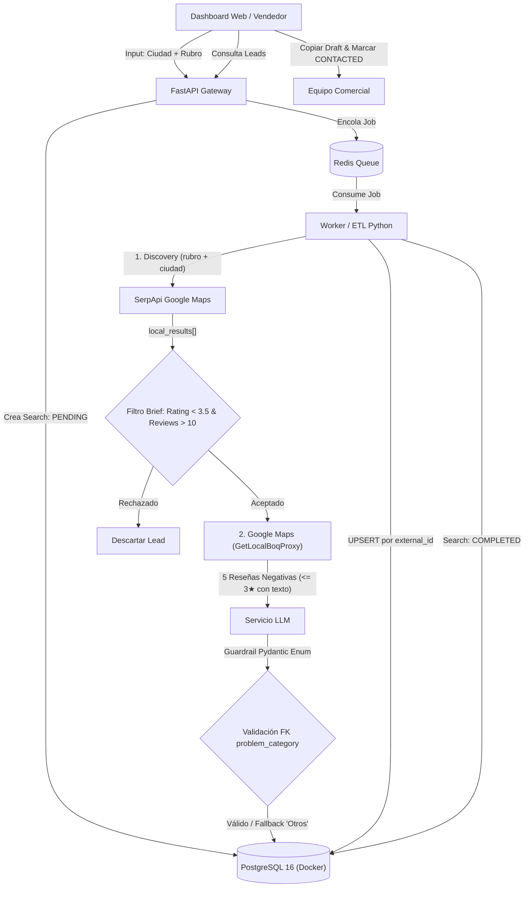

# RepuSense — Radar de Reputación en Crisis (QA & Testing)
> **B2B SaaS / Automatización de Prospección Comercial & Gestión Reputacional**  
> *Simulación Laboral — NoCountry (`S10-26-equipo6-B2B`)*

[](https://www.python.org/)
[](https://docs.pytest.org/)
[-336791.svg)](https://www.postgresql.org/)

---

## 1. Contexto de Negocio y el Problema Operativo

La empresa es una agencia de relaciones públicas y marketing digital especializada en recuperación de reputación local (restaurantes, clínicas, servicios) y mitigación de crisis.

* **El Cuello de Botella:** Un equipo de 3 vendedores invertía ~30 horas semanales en la búsqueda manual de negocios con baja calificación (`< 3.5 ★`) en directorios, produciendo apenas **40 leads semanales**.
* **La Solución RepuSense:** Automatizar la ingesta de prospectos mediante un pipeline asíncrono, enriquecer el análisis de quejas con Inteligencia Artificial (LLM) y generar automáticamente borradores de correos en frío para escalar a **cientos de contactos calificados por semana**.

---

## 2. Flujo Arquitectónico del Sistema



---

## 3. Estrategia de Calidad (Shift-Left & Risk-Based Testing)

Aplicamos **Shift-Left Testing** para blindar los riesgos arquitectónicos críticos antes del despliegue:

| Riesgo Técnico / Arquitectónico | Blast Radius | Mitigación Implementada |
| :--- | :--- | :--- |
| **Límites de Cuota / Bloqueo (HTTP 429)** en SerpApi y `GetLocalBoqProxy`. | Interrupción de ingesta o agotamiento de las 250 búsquedas/mes del plan gratuito. | Test Harness desacoplado con *Golden Datasets* locales; tasa de cortesía configurable (`~1 req/s` en reseñas, `2.0s` en discovery) sin navegador headless. |
| **Duplicación de Leads** por re-ejecución de búsquedas. | Venta repetida al mismo cliente; pérdida de trazabilidad del ciclo comercial. | Validación de idempotencia en PostgreSQL mediante clave única `external_id` en `business_source`, conservando el `lead_status` existente. |
| **Alucinación en Clasificación LLM** (`problem_category`). | Violación de integridad referencial (`SQL Error 23503 foreign_key_violation`). | Escudo Pydantic Enum con fallback determinístico a `"Otros"` y registro de log estructurado `[LLM_HALLUCINATION_DETECTED]`. |
| **Flakiness en CI/CD** por dependencia de red externa. | Falsos negativos y bloqueos en Pull Requests. | Aislamiento de capas: inyección de transporte HTTP simulado en `pytest`, contenedores Docker locales y suite determinística. |

---

## 4. Estructura del Módulo de QA (`repusense-qa/`)

El directorio `repusense-qa/` organiza los artefactos de estrategia, diseño de casos, *Golden Datasets* y suites de automatización de acuerdo con el avance incremental de las semanas del proyecto, consumiendo directamente los módulos del monorepo (`../backend` y `../docs`):

```text
repusense-qa/
├── docs/
│   ├── 01_strategy/
│   │   └── test-strategy.md                # Fase 1: Alcance In/Out, riesgos y Quality Gates
│   └── 02_design/
│       └── test-scenarios.md               # Fase 2: Matrices BVA, clases de equivalencia y RTM
├── automation/
│   ├── data/
│   │   └── golden_datasets/                # Semana 2 (Tarea 1): JSON estáticos para pruebas sin red
│   │       ├── serpapi_discovery_bva.json
│   │       ├── dataset_critico_cotocollao.json
│   │       └── payload_corrupto_boqproxy.json
│   ├── tests/
│   │   ├── conftest.py                     # Fixtures de Pytest y configuración determinista del brief
│   │   ├── unit/                           # Semana 2: Pruebas unitarias y BVA (Issues #36 y #40)
│   │   │   ├── test_discovery_bva.py
│   │   │   └── test_resenas_extractor.py
│   │   ├── contract/                       # Semana 2-3: Validación de esquemas Pydantic y DTOs
│   │   │   └── test_discovery_schema.py
│   │   ├── integration/                    # Semana 2-3 (Planificado): Idempotencia SQL y colas Redis
│   │   └── e2e/                            # Semana 4 (Planificado): Flujo E2E con Playwright
│   └── src/                                # Semana 3-4 (Planificado): Clientes API y Page Objects (POM)
├── pytest.ini                              # Configuración de Pytest (pythonpath = ../backend)
└── README.md
```

> **Referencias en la raíz del monorepo:**
> * Contrato de reseñas: [`../docs/fuente-de-resenas.md`](../docs/fuente-de-resenas.md) e implementación en [`../backend/app/etl/resenas.py`](../backend/app/etl/resenas.py).
> * Contrato de discovery: [`../docs/fuente-de-discovery.md`](../docs/fuente-de-discovery.md) e implementación en [`../backend/app/providers/discovery.py`](../backend/app/providers/discovery.py).
> * Diseño del sistema y modelo de 9 tablas: [`../docs/systemDesign.md`](../docs/systemDesign.md).
