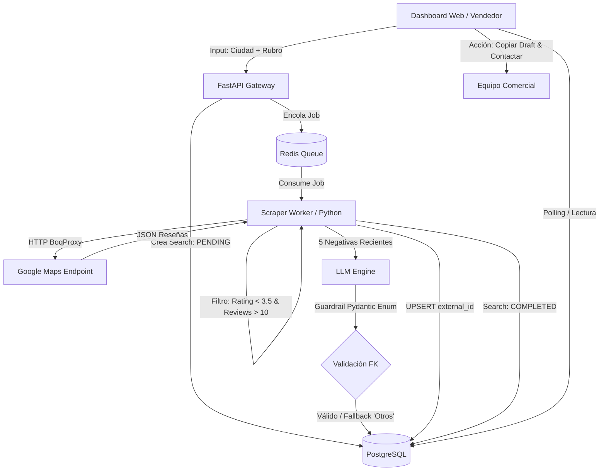

# RepuSense — Radar de Reputación en Crisis
> **B2B SaaS / Automatización de Prospección Comercial & Gestión Reputacional**  
> *Simulación Laboral Abierta — NoCountry*

[](https://github.com/mvelez2793/repusense-qa/actions)
[](https://www.python.org/)
[](https://docs.pytest.org/)
[](https://supabase.com/)

---

## 1. Contexto de Negocio y el Problema Operativo

La empresa es una agencia de relaciones públicas y marketing digital especializada en recuperación de reputación local (restaurantes, clínicas, servicios) y mitigación de crisis.

* **El Cuello de Botella:** Un equipo de 3 vendedores invertía ~30 horas semanales en la búsqueda manual de negocios con baja calificación (1.5 a 3.5 ★) en directorios, produciendo apenas **40 leads semanales**.
* **La Solución RepuSense:** Automatizar la ingesta de prospectos mediante un pipeline asíncrono, enriquecer el análisis de quejas con Inteligencia Artificial (LLM) y generar automáticamente borradores de correos en frío para escalar a **cientos de contactos calificados por semana**.

---

## 2. Flujo Arquitectónico del Sistema


---
### 3. Estrategia de Calidad (Shift-Left & Risk-Based Testing)

Como estrategia de ingeniería de calidad, aplicamos **Shift-Left Testing** para blindar los riesgos arquitectónicos críticos antes de la fase de despliegue.

| Riesgo Técnico / Arquitectónico | Blast Radius | Mitigación Implementada |
| :--- | :--- | :--- |
| **Bloqueo Anti-Bot (HTTP 429)** en Google Maps. | Caída total de ingesta; cero leads nuevos. | Test Harness desacoplado con *Golden Datasets* locales; consumo de `GetLocalBoqProxy` con tasa de cortesía (~1 req/s) sin browser headless vulnerable. |
| **Duplicación de Leads** por re-ejecución de búsquedas. | Venta repetida al mismo cliente; daño reputacional directo a la agencia. | Validación de idempotencia en PostgreSQL mediante clave única `external_id` en `business_source`, conservando el `lead_status` existente. |
| **Alucinación en Clasificación LLM** (`problem_category`). | Violación de integridad referencial (SQL Error 23503 *foreign_key_violation*). | Escudo Pydantic Enum con fallback automático a "Otros" y registro de log estructurado `[LLM_HALLUCINATION_DETECTED]`. |
| **Flakiness en CI/CD** por dependencia externa. | Falsos negativos y bloqueos en Pull Requests. | Aislamiento de capas: Mocks HTTP, bases de datos efímeras en contenedor y suite de *Smoke Tests* determinística. |


---
### 4. Estructura del Repositorio

El proyecto implementa una arquitectura limpia separando documentación estratégica, datos de prueba y framework de automatización:

```text
repusense-qa/
├── docs/
│   ├── 01_strategy/
│   │   └── test-strategy.md            # Alcance In/Out, riesgos y métricas DORA
│   ├── 02_design/
│   │   ├── test-scenarios.md           # Matrices de cobertura BVA y clases de equivalencia
│   │   └── traceability-matrix.md      # Mapeo Criterios de Aceptación ↔ Casos de Prueba
│   └── fuente-de-resenas.md            # Contrato verificado de GetLocalBoqProxy
├── automation/
│   ├── src/
│   │   ├── api_clients/                # Clientes tipados FastAPI
│   │   ├── schemas/                    # Contratos Pydantic y Enums con Fallback
│   │   └── pages/                      # Page Object Model (POM) para Dashboard
│   ├── tests/
│   │   ├── unit/                       # Parsing y sanitización del extractor
│   │   ├── contract/                   # Validación de esquemas y DTOs
│   │   ├── integration/                # Idempotencia en PostgreSQL y colas Redis
│   │   └── e2e/                        # Flujo crítico de prospección (Playwright)
│   └── data/
│       └── golden_datasets/            # Mocks JSON estáticos para pruebas aisladas
├── scripts/
│   └── obtener_resenas.py              # Script base verificado de extracción anónima
├── .github/
│   ├── workflows/                      # Pipelines de CI/CD (Ruff + Smoke Tests)
│   └── PULL_REQUEST_TEMPLATE.md        # Plantilla formal de entrega
├── pytest.ini
└── README.md
```
---
