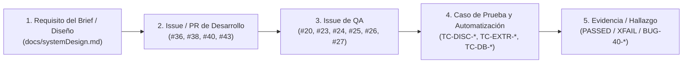

# Matriz de Trazabilidad de Requisitos y Pruebas (RTM)
**Equipo:** S10-26-equipo6-B2B — RepuSense  
**Área:** Quality Assurance & Testing (`repusense-qa`)

---

## 1. ¿Cómo funciona la Trazabilidad Bidireccional (Forward & Backward Traceability)?

En ingeniería de calidad (ISTQB), la trazabilidad conecta **4 eslabones** para que ningún requisito de negocio quede sin probar y ningún test exista sin propósito:

* **Trazabilidad hacia adelante (Forward):** Desde el requisito del cliente (*"negocios con `< 3.5` estrellas y `> 10` reseñas"*) → hasta el test en Python (`test_tc_disc_01...`). Garantiza **100% de cobertura**.
* **Trazabilidad hacia atrás (Backward):** Desde un test que falla (`test_tc_disc_deduplicacion_place_id_entre_paginas`) → hacia el código (`discovery.py`), el Issue de Dev (`#40`) y el riesgo de negocio (*"no duplicar leads"*). Permite medir el **Blast Radius** de un bug.

---

## 2. Matriz Maestra de Trazabilidad (Requisitos ↔ Dev Issues ↔ QA Issues ↔ Tests)

| ID Requisito | Regla de Negocio / Criterio de Aceptación | Issue / PR de Desarrollo | Tu Issue de QA | ID Caso (`test-scenarios.md`) | Test Automatizado (`repusense-qa/automation/tests/`) | Estado Actual |
| :--- | :--- | :--- | :--- | :--- | :--- | :---: |
| **RF-01** | Filtrar negocios por `rubro + ciudad` con `rating < 3.5` y `reviews > 10` | [#37](https://github.com/No-Country-simulation/S10-26-equipo6-B2B/issues/37), [#40](https://github.com/No-Country-simulation/S10-26-equipo6-B2B/issues/40) (PR #41) | [#20](https://github.com/No-Country-simulation/S10-26-equipo6-B2B/issues/20) (PR #51) | `TC-DISC-01` `TC-DISC-02` `TC-DISC-03` | `unit/test_discovery_bva.py` `contract/test_discovery_schema.py` | ✅ `PASSED` |
| **RF-02** | Paginación obligatoria vía `serpapi_pagination.next` (~120 resultados máx.) e intervalo de cortesía | [#40](https://github.com/No-Country-simulation/S10-26-equipo6-B2B/issues/40) (PR #41) | [#20](https://github.com/No-Country-simulation/S10-26-equipo6-B2B/issues/20) (PR #51) | `TC-DISC-04` | `unit/test_discovery_bva.py::test_tc_disc_04_...` `unit/test_discovery_bva.py::test_tc_disc_rate_limiting...` | ✅ `PASSED` |
| **RF-03** | Extraer las 5 reseñas negativas más recientes (`<= 3★` con texto) y sanitizar HTML | [#8](https://github.com/No-Country-simulation/S10-26-equipo6-B2B/issues/8), [#11](https://github.com/No-Country-simulation/S10-26-equipo6-B2B/issues/11), [#36](https://github.com/No-Country-simulation/S10-26-equipo6-B2B/issues/36) (PR #45, #47) | [#20](https://github.com/No-Country-simulation/S10-26-equipo6-B2B/issues/20) (PR #51) | `TC-EXTR-01` `TC-EXTR-02` `TC-EXTR-03` | `unit/test_resenas_extractor.py` `contract/test_discovery_schema.py` | ✅ `PASSED` |
| **RNF-01** | Resiliencia ante bloqueo/cuota (`HTTP 429`) con reintento/backoff y estado `FAILED` en DB | [#40](https://github.com/No-Country-simulation/S10-26-equipo6-B2B/issues/40), [#43](https://github.com/No-Country-simulation/S10-26-equipo6-B2B/issues/43) | [#23](https://github.com/No-Country-simulation/S10-26-equipo6-B2B/issues/23) (Tarea 2) | `TC-DISC-05` | `unit/test_discovery_bva.py::test_tc_disc_05_...` | ⚠️ `XFAIL` (`BUG-40-02`) / Pendiente #43 |
| **RNF-02** | Idempotencia y cero duplicados por `external_id` (`place_id` / `CID`) sin pisar `lead_status` | [#9](https://github.com/No-Country-simulation/S10-26-equipo6-B2B/issues/9), [#38](https://github.com/No-Country-simulation/S10-26-equipo6-B2B/issues/38), [#40](https://github.com/No-Country-simulation/S10-26-equipo6-B2B/issues/40) | [#24](https://github.com/No-Country-simulation/S10-26-equipo6-B2B/issues/24) (Tarea 3) | `TC-DISC-DUP` `TC-DB-01` `TC-DB-02` | `unit/test_discovery_bva.py::test_tc_disc_deduplicacion...` | ⚠️ `XFAIL` (`BUG-40-01`) / 🚫 `BLOCKED` por #38 |
| **RF-04** | Contrato de API (`POST /api/v1/busquedas`) y Escudo Pydantic LLM con fallback a `"Otros"` (`SQL 23503`) | [#43](https://github.com/No-Country-simulation/S10-26-equipo6-B2B/issues/43) | [#25](https://github.com/No-Country-simulation/S10-26-equipo6-B2B/issues/25) (Tarea 4) | `TC-DB-03` | `contract/test_discovery_schema.py` (parcial) | 🚫 `BLOCKED` por #43 |
| **RNF-03** | Quality Gate continuo en GitHub Actions (`ruff` + `pytest`) | [#31](https://github.com/No-Country-simulation/S10-26-equipo6-B2B/issues/31), [#49](https://github.com/No-Country-simulation/S10-26-equipo6-B2B/issues/49) | [#26](https://github.com/No-Country-simulation/S10-26-equipo6-B2B/issues/26) (Tarea 5) | Quality Gate CI | `.github/workflows/pr-quality-gate.yml` (Semana 3) | ⏳ Planificado Sem. 3 |
| **RF-05** | Flujo E2E en Dashboard: filtrar `< 3.5★`, copiar draft y marcar `CONTACTED` | [#7](https://github.com/No-Country-simulation/S10-26-equipo6-B2B/issues/7), [#16](https://github.com/No-Country-simulation/S10-26-equipo6-B2B/issues/16) | [#27](https://github.com/No-Country-simulation/S10-26-equipo6-B2B/issues/27) (Tarea 6) | E2E Playwright | `e2e/` (Semana 4) | ⏳ Planificado Sem. 4 |
